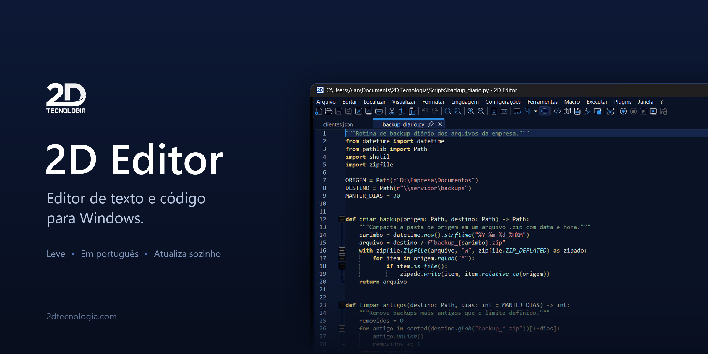
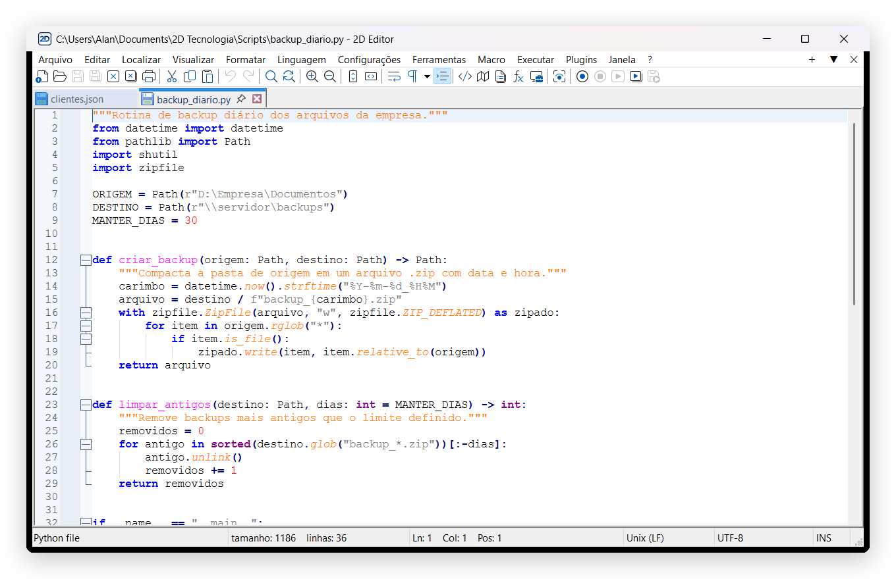
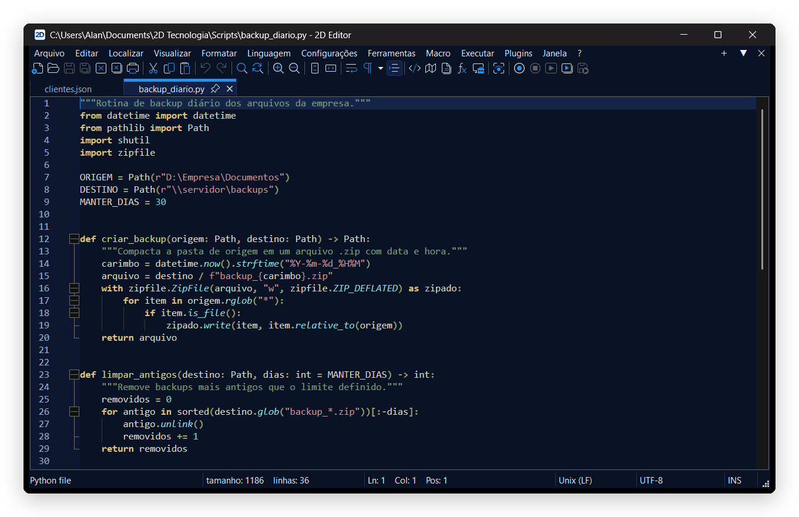
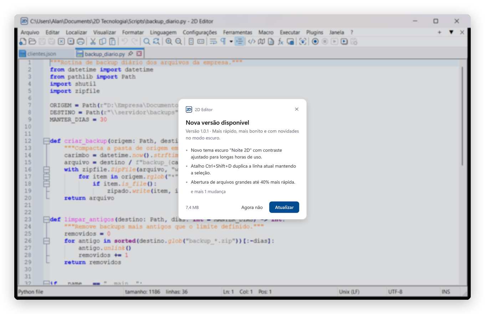

<p align="center">
  
</p>

<p align="center">
  <a href="https://github.com/alanaraujo-bit/2d-editor/releases/latest"></a>
  <a href="https://github.com/alanaraujo-bit/2d-editor/releases"></a>
  
  <a href="LICENSE"></a>
  <a href="https://github.com/alanaraujo-bit/2d-editor/stargazers"></a>
</p>

<h3 align="center">Rápido, leve e todo em português.</h3>

<p align="center">
  Um editor de texto e código para Windows que abre em instantes, entende dezenas de linguagens<br>
  e se atualiza sozinho. Feito pela <a href="https://2dtecnologia.com/">2D Tecnologia</a>.
</p>

<p align="center">
  <a href="https://github.com/alanaraujo-bit/2d-editor/releases/latest/download/2D-Editor-Setup.exe"></a>
</p>

<p align="center">
  <sub>Gratuito · 8 MB · Não precisa de administrador · <a href="https://github.com/alanaraujo-bit/2d-editor/releases/latest">Todas as versões</a></sub>
</p>

<br>

## Por que o 2D Editor

<table>
  <tr>
    <td width="33%" valign="top">
      <h4>Leve de verdade</h4>
      Abre em instantes e roda bem em qualquer computador, inclusive nos mais simples. Arquivos grandes abrem sem travar.
    </td>
    <td width="33%" valign="top">
      <h4>Feito para quem fala português</h4>
      Menus, mensagens e configurações em português do Brasil. Se precisar de ajuda, o suporte é por WhatsApp, direto do menu.
    </td>
    <td width="33%" valign="top">
      <h4>Sempre atualizado</h4>
      Quando sai uma versão nova, o 2D Editor avisa, mostra o que mudou e se atualiza com um clique. Sem baixar instalador de novo.
    </td>
  </tr>
</table>

## Conheça

<table>
  <tr>
    <td width="50%"></td>
    <td width="50%"></td>
  </tr>
  <tr>
    <td align="center"><sub>Tema claro</sub></td>
    <td align="center"><sub>Modo escuro</sub></td>
  </tr>
</table>

### Atualização automática

<p align="center">
  
</p>

Ao abrir, o 2D Editor verifica em segundo plano se há uma versão nova. Se houver, aparece um cartão discreto com as principais mudanças. Em **Atualizar**, ele baixa, confere a integridade do arquivo, instala e reabre o editor sozinho. Se houver arquivos sem salvar, ele pergunta antes de fechar.

## Recursos

**Edição**
- Realce de sintaxe para mais de 80 linguagens: Python, JavaScript, C#, PHP, SQL, HTML, CSS, JSON, XML, PowerShell, Batch e muitas outras
- Dobra de código, autocompletar, edição em várias linhas ao mesmo tempo e seleção em coluna
- Conversão de codificação (UTF-8, ANSI…) e de quebras de linha (Windows, Unix, Mac)

**Busca**
- Localizar e substituir com expressões regulares
- Busca em pastas inteiras, com resultados agrupados por arquivo
- Marcação de todas as ocorrências da palavra selecionada

**Produtividade**
- Abas, sessões, tela dividida, mapa do documento e lista de funções
- Macros para gravar e repetir tarefas
- Suporte a plugins para ampliar o editor

**Visual**
- Modo claro e modo escuro com as cores da 2D Tecnologia
- Temas de cores, fontes e zoom configuráveis

## Instalação

1. Baixe o [instalador](https://github.com/alanaraujo-bit/2d-editor/releases/latest/download/2D-Editor-Setup.exe).
2. Abra o arquivo e avance. Não precisa ser administrador.
3. Pronto. A partir daí, as atualizações chegam sozinhas.

> **"O Windows protegeu o computador"?** É o aviso padrão para programas novos. Clique em **Mais informações → Executar assim mesmo**.

<details>
<summary><b>Versão portátil</b> (sem instalar)</summary>
<br>

Baixe o [`2D-Editor-Portable.zip`](https://github.com/alanaraujo-bit/2d-editor/releases/latest/download/2D-Editor-Portable.zip), descompacte em qualquer pasta (ou pen drive) e abra o `2DEditor.exe`. As configurações ficam na própria pasta, e as atualizações automáticas também funcionam.
</details>

<details>
<summary><b>Instalação em várias máquinas</b> (silenciosa)</summary>
<br>

```powershell
.\2D-Editor-Setup.exe /VERYSILENT /CURRENTUSER /TASKS=desktopicon,contextmenu
```

Use `/ALLUSERS` no lugar de `/CURRENTUSER` para instalar para todos os usuários (exige administrador).
</details>

**Requisitos:** Windows 10 ou 11, 64 bits.

## Atalhos essenciais

| Atalho | Ação |
|---|---|
| <kbd>Ctrl</kbd> <kbd>F</kbd> / <kbd>Ctrl</kbd> <kbd>H</kbd> | Localizar / Substituir |
| <kbd>Ctrl</kbd> <kbd>Shift</kbd> <kbd>F</kbd> | Localizar em arquivos de uma pasta |
| <kbd>Ctrl</kbd> <kbd>G</kbd> | Ir para a linha |
| <kbd>Ctrl</kbd> <kbd>D</kbd> | Duplicar a linha ou a seleção |
| <kbd>Ctrl</kbd> <kbd>Shift</kbd> <kbd>L</kbd> | Apagar a linha |
| <kbd>Ctrl</kbd> <kbd>Shift</kbd> <kbd>↑</kbd> <kbd>↓</kbd> | Mover a linha para cima / para baixo |
| <kbd>Ctrl</kbd> <kbd>Q</kbd> | Comentar / descomentar |
| <kbd>Alt</kbd> + arrastar | Selecionar em coluna |
| <kbd>Ctrl</kbd> + roda do mouse | Zoom |
| <kbd>F11</kbd> | Tela cheia |

## Para empresas

A [2D Tecnologia](https://2dtecnologia.com/) oferece suporte de TI completo para empresas: implantação do 2D Editor e de outras ferramentas em todas as máquinas, backup em nuvem, redes, e-mail corporativo e suporte remoto.

[Monte seu plano](https://2dtecnologia.com/monte-seu-plano.html) · [Fale no WhatsApp](https://wa.me/5531997788973)

## Perguntas frequentes

<details>
<summary><b>É gratuito?</b></summary>
<br>
Sim, para uso pessoal e comercial. O 2D Editor é software livre (GPL v3).
</details>

<details>
<summary><b>Meus arquivos saem do meu computador?</b></summary>
<br>
Não. O editor funciona totalmente offline. A única conexão é a consulta de atualizações, que só verifica se há uma versão nova.
</details>

<details>
<summary><b>Posso desativar a atualização automática?</b></summary>
<br>
Sim: <b>Configurações → Preferências → Diversos</b>. Você também pode verificar quando quiser em <b>? → Verificar atualizações</b>.
</details>

<details>
<summary><b>Como desinstalar?</b></summary>
<br>
Pelo Windows: <b>Configurações → Aplicativos → 2D Editor → Desinstalar</b>.
</details>

## Sugestões e problemas

Encontrou um problema ou tem uma ideia? [Abra uma issue](https://github.com/alanaraujo-bit/2d-editor/issues/new/choose). Toda sugestão é lida.

Se o 2D Editor facilita o seu dia a dia, **deixe uma estrela** no topo da página. Isso ajuda outras pessoas a encontrarem o projeto.

<details>
<summary><b>Compilar a partir do código</b></summary>
<br>

Requisitos: MinGW-w64 (GCC), .NET SDK 8 e Inno Setup 7.

```powershell
cd PowerEditor\gcc
mingw32-make -j12                                           # editor
dotnet build ..\..\2d\updater\2DUpdater.csproj -c Release   # atualizador
```

A pasta [`2d/`](2d/) reúne o atualizador, o instalador, os scripts de empacotamento e lançamento, a identidade visual e as notas de cada versão.
</details>

<br>

<p align="center">
  <a href="https://2dtecnologia.com/"></a>
  <br>
  <sub><b>2D Tecnologia</b> · Tecnologia em favor da sua empresa</sub>
  <br>
  <sub><a href="https://2dtecnologia.com/">2dtecnologia.com</a> · <a href="https://wa.me/5531997788973">WhatsApp</a> · <a href="https://instagram.com/2dtecnologiaa">Instagram</a></sub>
  <br><br>
  <sub>Software livre sob a <a href="LICENSE">GNU GPL v3</a>.</sub>
</p>
